<p align="center">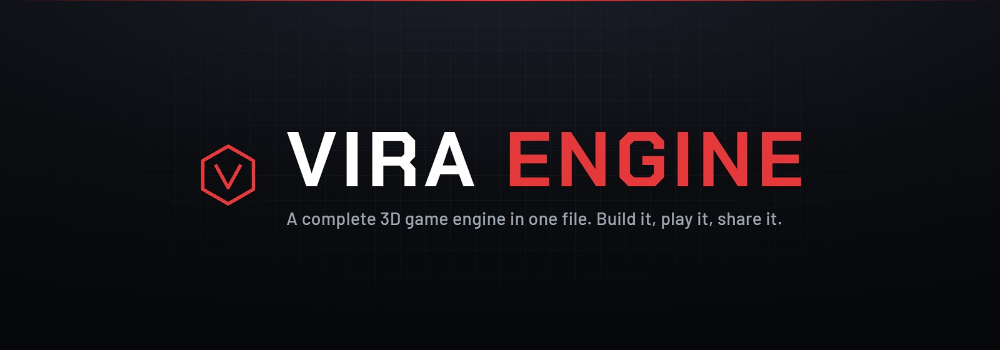</p>

<h3 align="center">A complete 3D game engine in one file.</h3>
<p align="center">No installer. No account. No internet. Open it and build.</p>

<p align="center">
  <a href="#getting-started">Getting started</a> &nbsp;·&nbsp;
  <a href="#what-is-inside">What is inside</a> &nbsp;·&nbsp;
  <a href="#example-projects">Examples</a> &nbsp;·&nbsp;
  <a href="#specifications">Specifications</a> &nbsp;·&nbsp;
  <a href="#building-from-source">Source</a>
</p>

<br>

## Introducing Vira

Vira Engine is a game engine that opens like a web page. One HTML file holds the editor, the runtime, the libraries, the fonts and your project, and it runs on anything with a browser. Download it, open it, and you are building. When you are done, Export writes your game as another single file that anyone can open.

It is made for one person with an idea. Nothing has to be coded: levels are drawn, logic reads as sentences, models are sculpted like clay, and the interface is designed on a screen that looks exactly like the game. Every tool lives in the same window, and every change shows up the moment you make it.

<p align="center">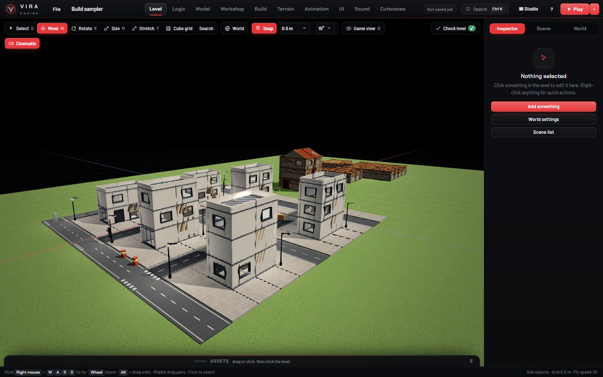</p>
<p align="center"><sub>The Level tab. The town, the keep and the dungeon were made in the Build tab in a few clicks.</sub></p>

<br>

## What is inside

<table>
<tr>
<td width="33%" valign="top"><b>Build</b><br><sub>Modular kits in five styles, smart rooms, whole buildings, and seeded dungeons, towns, forests and caves. Automatic collision. Everything snaps.</sub></td>
<td width="33%" valign="top"><b>Model</b><br><sub>A sculpting mode that behaves like clay, with brushes, mirror, pen pressure and studio materials. Build props from shapes, or import glTF and OBJ.</sub></td>
<td width="33%" valign="top"><b>Logic</b><br><sub>Behaviors written as sentences: when this happens, check that, do this. A debugger that shows what ran while you played.</sub></td>
</tr>
<tr>
<td valign="top"><b>UI</b><br><sub>Menus, HUDs, inventories, dialogue windows and loading screens with themes, effects, animations, a logo maker and gamepad navigation.</sub></td>
<td valign="top"><b>World</b><br><sub>Terrain, lights with animation modes, keyframe animation, cutscenes with lenses and letterbox, a music studio and a sound maker.</sub></td>
<td valign="top"><b>Play</b><br><sub>Desktop with mouse, keyboard or gamepad. VR headsets through WebXR, with hands that punch, grab and throw. Roguelite runs that build new floors every time.</sub></td>
</tr>
</table>

<br>

## Build worlds, not walls

The Build tab works at the scale you think at. Drag a rectangle and you get a room: floor, walls, windows, a door, and a doorway into the room next to it. Pick a piece and drag along a line for a row of walls, or across a square for a patch of floor. Corner posts appear where walls meet and leave when they are no longer needed. Put a doorway on a wall and the wall opens.

Thirty-five pieces come in five styles. Sci-fi panels with light strips. Medieval stone with timber beams. Modern plaster and oak. Industrial corrugated steel with hazard paint. Horror wallpaper with boarded windows. Restyle one piece, one floor, or the whole level in a click.

<table>
<tr>
<td width="50%">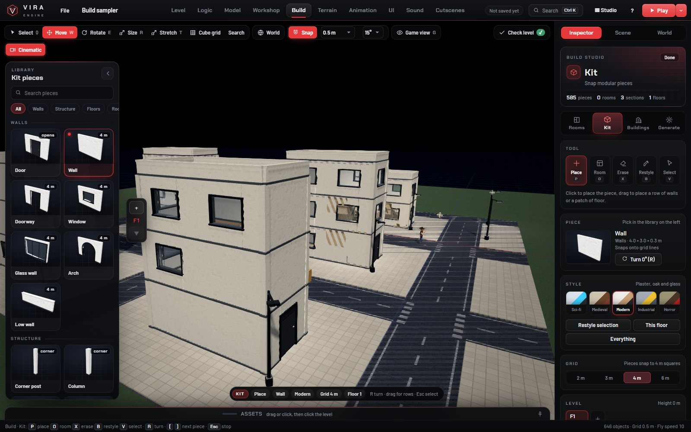</td>
<td width="50%">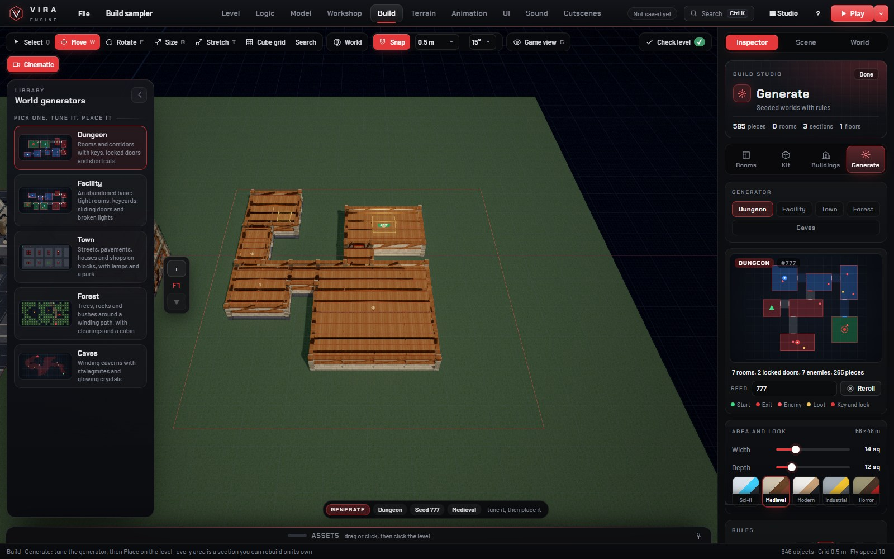</td>
</tr>
<tr>
<td><sub>Kit mode: a library with live previews, tools that snap, and a style for every piece.</sub></td>
<td><sub>Generate mode: a dungeon with keys, locked doors and a shortcut, previewed on a map before it is built.</sub></td>
</tr>
</table>

When you need more than a room, draw a footprint and get a building with floors, stairs, windows, a front door and a roof. When you need a whole place, generate one. Dungeons with keys hidden before their locked doors and shortcuts that open from the far side. Facilities with keycards and sliding doors. Towns with streets, pavements, houses, shops and a park. Forests with a winding path, clearings and a cabin. Caves with stalagmites and glowing crystals.

Every generated area is a section. Rebuild it with a new seed without touching anything else. Lock it. Keep it as hand-made. Or let it build a new layout every time the game starts, around whatever you placed by hand.

<br>

## Digital clay

Open the Model tab and the shape in front of you is clay. Draw, Clay, Smooth, Flatten, Inflate, Pinch, Crease, Grab and Paint, with mirror on X, pen pressure, Shift to smooth and Ctrl to subtract. Subdivide when you want more detail. Preview in clay, wax, jade, pearl, graphite or chrome. Save it as a part that places in levels and ships inside the exported game.

<p align="center">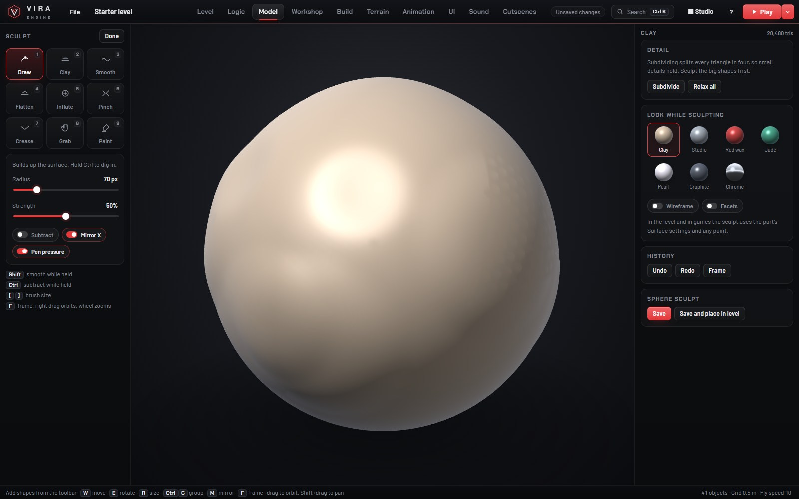</p>
<p align="center"><sub>Sculpt mode. Start from a sphere, cube, cylinder, ring or plane, or turn any part into clay.</sub></p>

Prefer building to sculpting? Box, Cylinder, Sphere, Cone, Ring, Capsule, Wedge, Pipe, Dome, Prism and Panel, with group, mirror, duplicate and templates for furniture, street props, containers and building parts.

<br>

## Logic that reads like a sentence

A behavior is a card. When the player enters the hint zone, check that the power is off, show a message. Otherwise show a different one. Click any highlighted word to change it. There are no graphs to untangle and no syntax to learn, and a debugger lists every event, check and action from your last play, with a count on every tile.

<p align="center">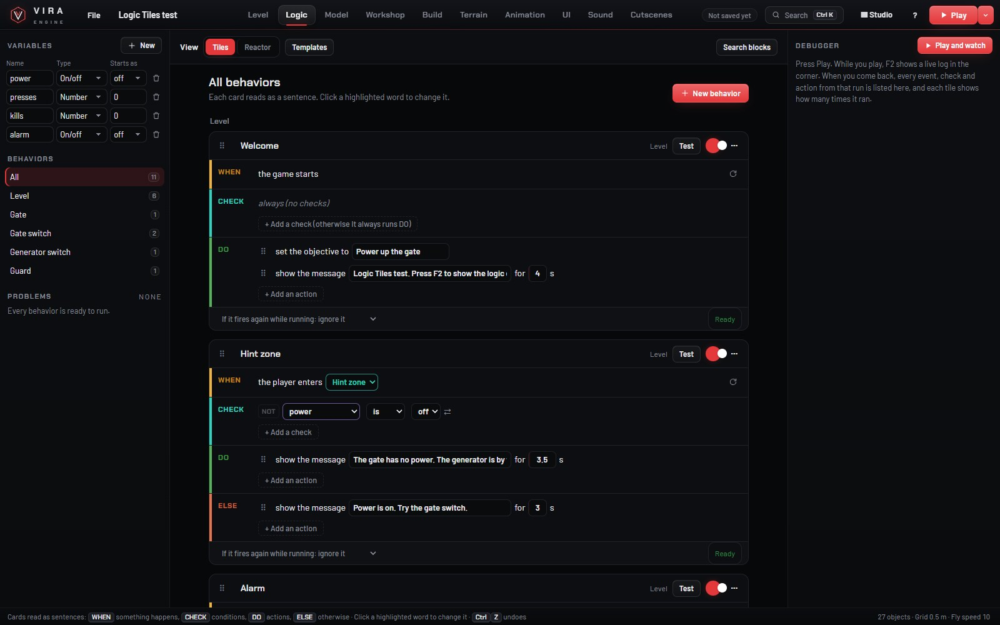</p>
<p align="center"><sub>Logic Tiles. Variables on the left, behaviors in the middle, the debugger on the right.</sub></p>

Logic reaches everything: doors, enemies, zones, variables, cutscenes, animations, sounds, screens, dialogue, VR rumble and roguelite runs. The Workshop goes further with crafts, which are parts, physics and behaviors wired together with Flow nodes, including your own player controllers.

<br>

## An interface you design on the screen it will play on

The UI tab is a 1280 × 720 stage, and what you see on it is what the game draws. Main menu, pause, death, win, loss, loading, settings, inventory, dialogue and any screen of your own. Make the full set in one click from a theme, then change anything: drag with smart guides, snap to the centre line and to other elements, resize with a handle, reorder in layers, and press Space to watch every animation play with values moving like in the game.

<table>
<tr>
<td width="50%">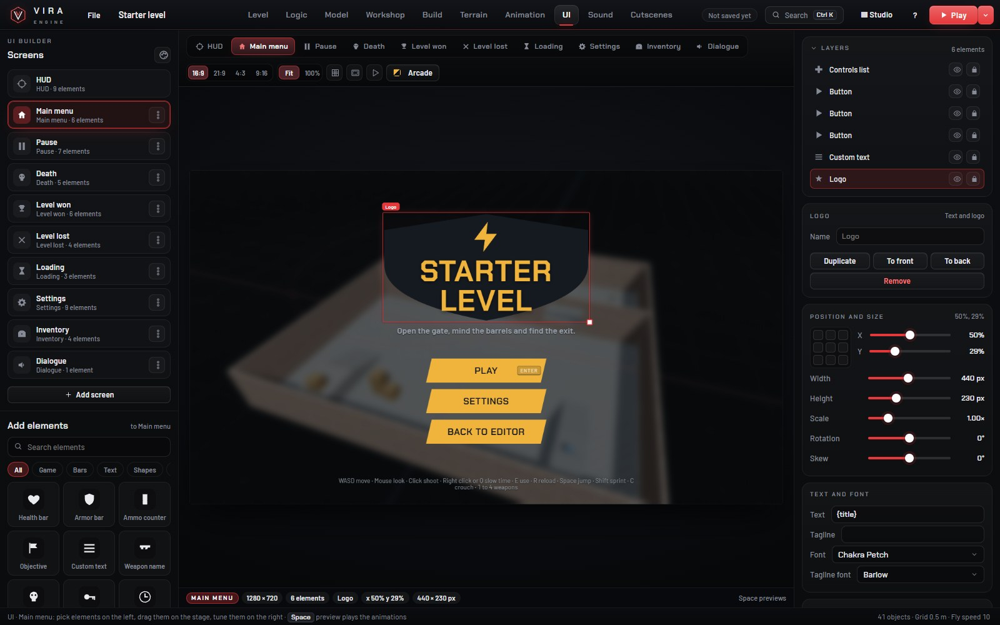</td>
<td width="50%">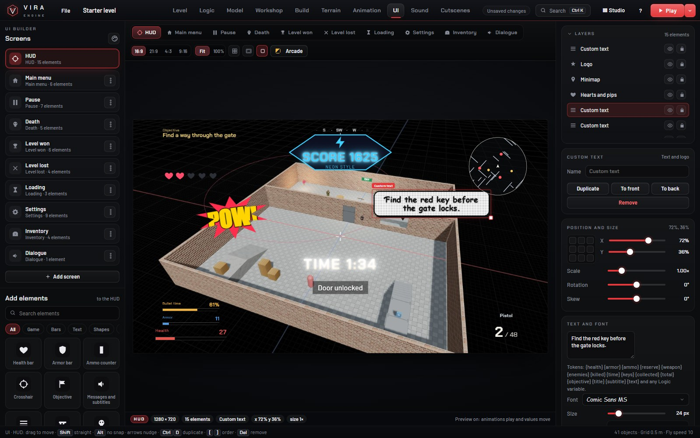</td>
</tr>
<tr>
<td><sub>The main menu on the stage, with its logo selected.</sub></td>
<td><sub>A HUD with a comic burst, a speech bubble, hearts, a neon logo and a minimap.</sub></td>
</tr>
</table>

Text takes tokens such as `{health}`, `{time}` or any Logic variable. Elements can have an outline, six kinds of shadow, plates behind them, speech bubbles, bursts and ribbons, gradient text and halftone dots. Nine entrance animations, eight idle motions, and a bump, flash or shake when a value changes. Nine themes restyle every screen at once and leave your hand-picked colours alone. Fonts come bundled, from the system, or from a file you import, and they ship inside the exported game.

<table>
<tr>
<td width="50%">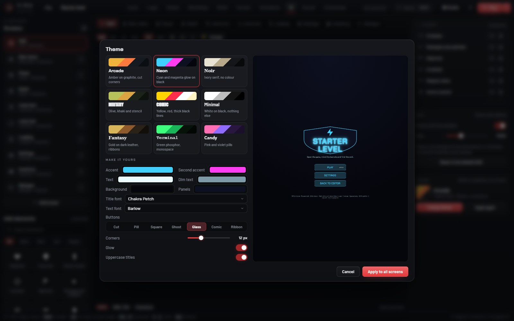</td>
<td width="50%">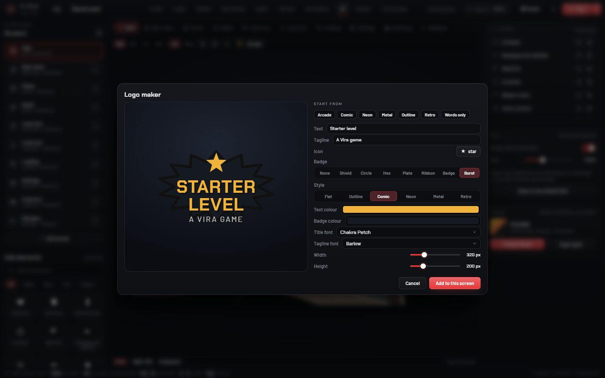</td>
</tr>
<tr>
<td><sub>Themes: colours, fonts and a button shape, previewed live on a real screen.</sub></td>
<td><sub>The logo maker: an icon, a badge, a style and your words.</sub></td>
</tr>
</table>

In the game, screens answer to the mouse, the keyboard and a gamepad, with a focus ring that moves the way you expect. Settings a player changes are remembered. The HUD grows with the window. A Logic Tile can open a screen, show dialogue with a portrait and typed-out text, or ask a question with up to three answers.

<table>
<tr>
<td width="33%">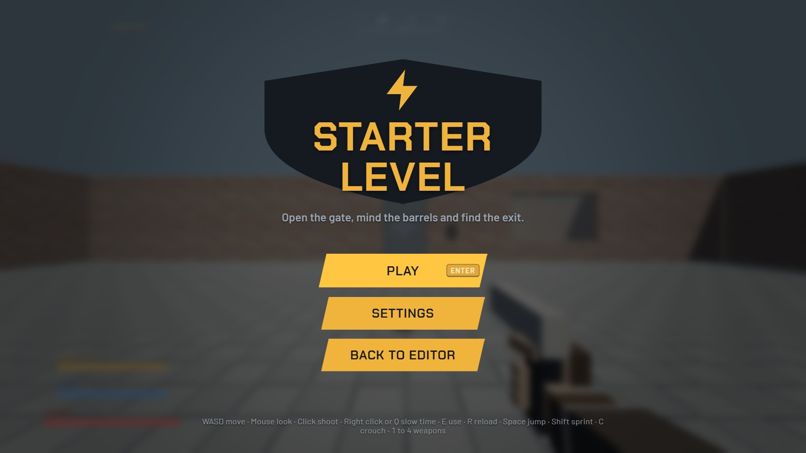</td>
<td width="33%">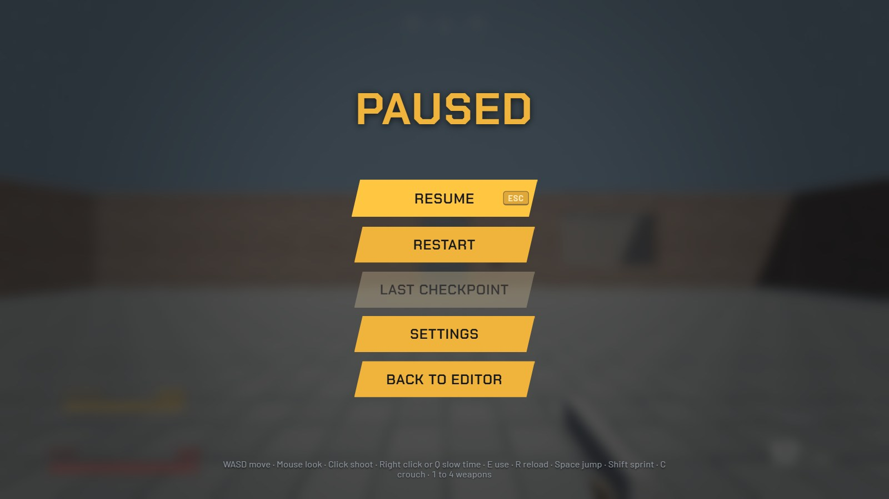</td>
<td width="33%">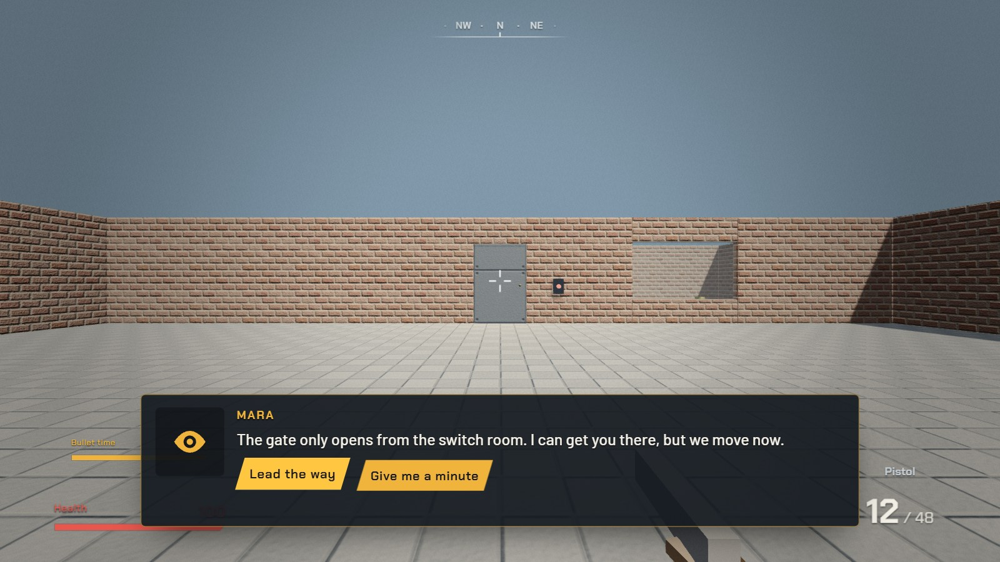</td>
</tr>
<tr>
<td><sub>A main menu, over the level.</sub></td>
<td><sub>Pause, with the level blurred behind it.</sub></td>
<td><sub>Dialogue with choices.</sub></td>
</tr>
</table>

<br>

## Play it. Then play it in VR.

Press Play and the level is a game: a first or third person camera, weapons with recoil and reload, enemies that patrol, guard, wander and hunt, slow time, checkpoints, keys and locked doors, breakable glass, ragdolls and a cinematic look with grain, vignette and colour grades.

<p align="center">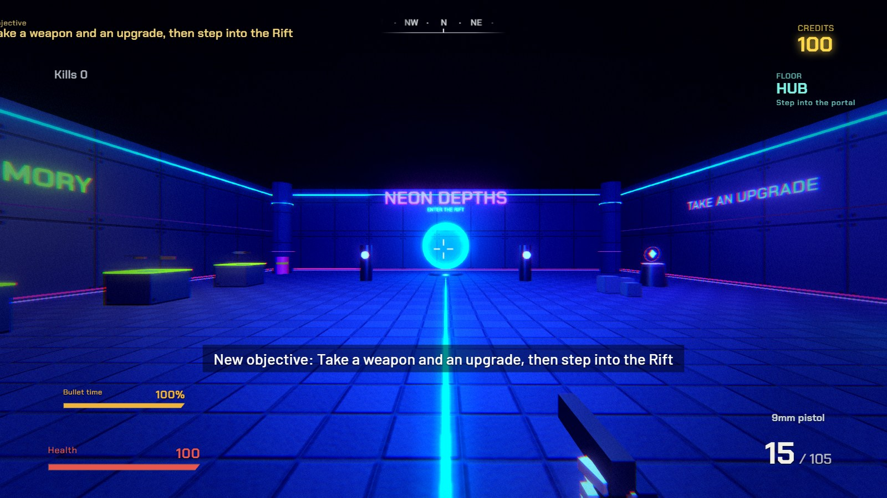</p>
<p align="center"><sub>Neon Depths, one of the example projects, at its hub.</sub></p>

Any game also plays in a WebXR headset, on Meta Quest or on PC VR through SteamVR or Quest Link. The left stick moves, the right stick turns, room-scale walking works and walls still block you. The gun sits in your hand with an aim laser, menus and the HUD float in the world, and your hands can punch, grab and throw props, pull one to your palm, block shots with what you hold, and knock slow bolts back.

<table>
<tr>
<td width="50%">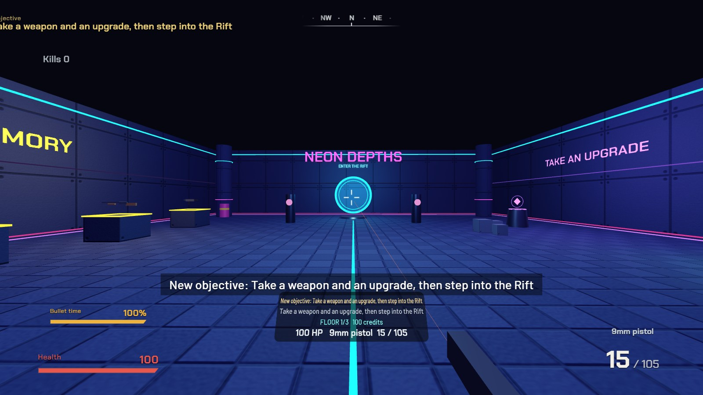</td>
<td width="50%" valign="top"><b>Roguelite runs</b><br><br><sub>Turn on Roguelite run in World settings and the game builds fresh floors every time you play: arena rooms that lock until cleared, treasure vaults, shops, upgrade shrines, elite rooms and a boss on the last floor. Credits, upgrades and weapons carry from floor to floor. Edit the upgrade list and the enemy roster as tables, choose a look, and preview a floor in the editor.</sub></td>
</tr>
<tr>
<td><sub>The simulated headset view, with the HUD floating in the world.</sub></td>
<td></td>
</tr>
</table>

<br>

## Terrain, animation, cutscenes, sound

<table>
<tr>
<td width="50%">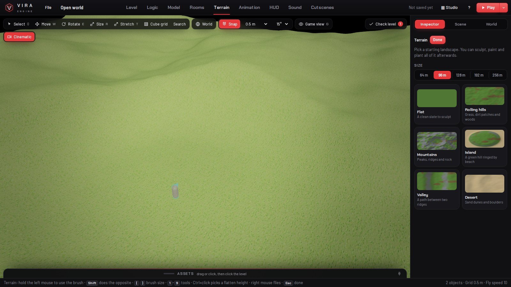</td>
<td width="50%">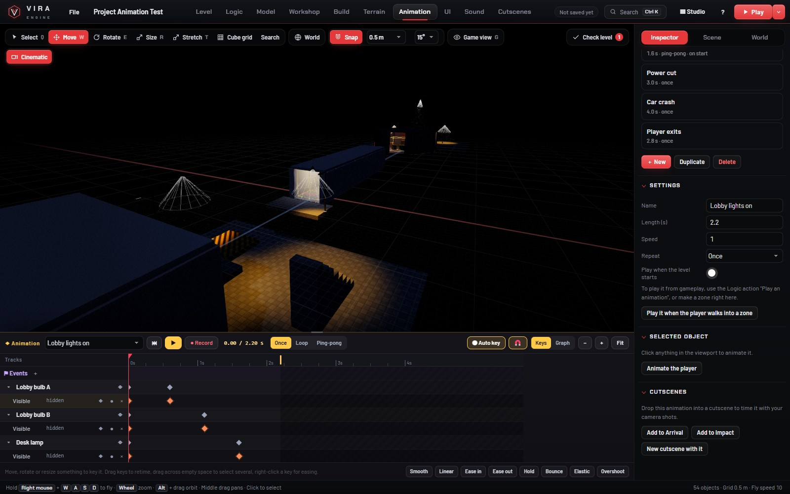</td>
</tr>
<tr>
<td><sub><b>Terrain.</b> Start from flat ground, rolling hills, mountains, an island, a valley or a desert, from 64 to 256 metres, then sculpt, paint and plant.</sub></td>
<td><sub><b>Animation.</b> Keyframe position, rotation, size and visibility on a timeline with a graph view, easing presets, record mode and events. Moving platforms carry the player.</sub></td>
</tr>
<tr>
<td>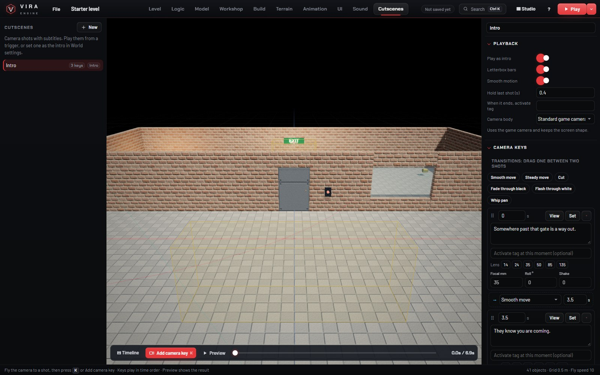</td>
<td>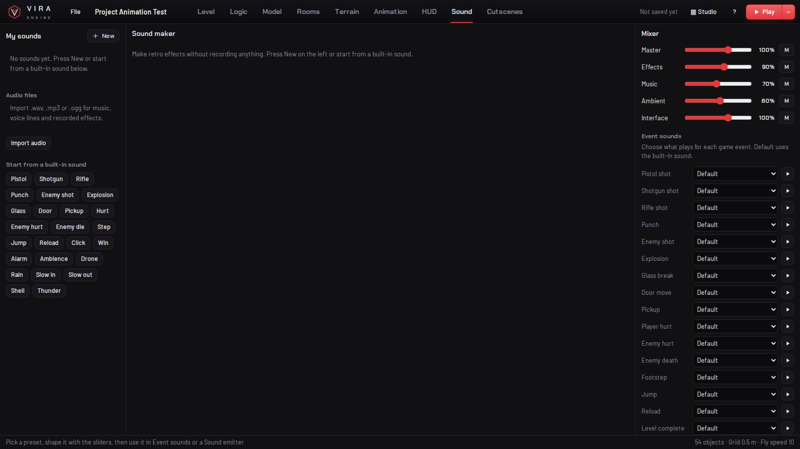</td>
</tr>
<tr>
<td><sub><b>Cutscenes.</b> Camera shots with lens choice, handheld shake, fades, cuts, whip pans, speed ramps, subtitles and animation clips, with letterbox bars and an intro that plays when the level starts.</sub></td>
<td><sub><b>Sound.</b> A music studio with patterns, lanes and a pattern maker, a sound maker with presets from pistols to rain, a voice recorder, and a mixer with master, effects, music, ambient and interface channels.</sub></td>
</tr>
</table>

<p align="center">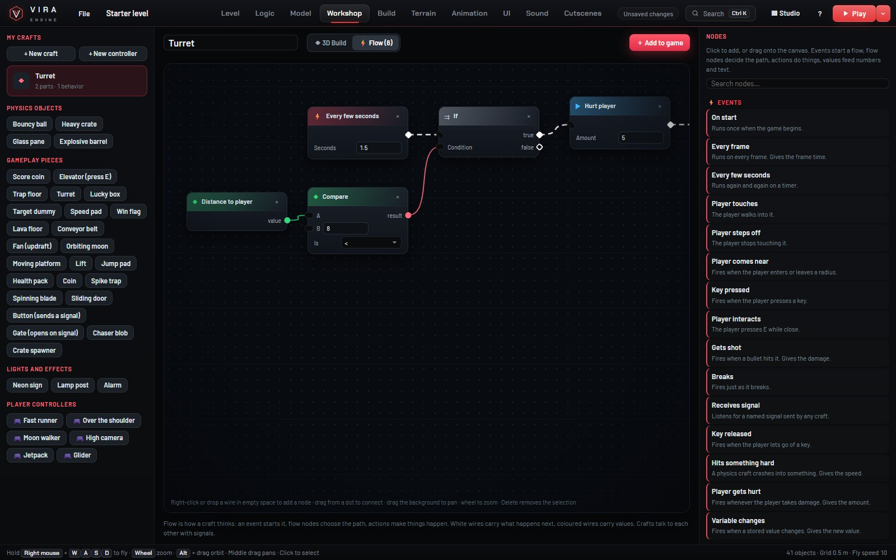</p>
<p align="center"><sub>The Workshop. Crafts are parts, physics and behaviors wired with Flow nodes, from a bouncy ball to a turret to a jetpack controller.</sub></p>

<br>

## Bring in games made elsewhere

File › Import HTML game takes a single-file HTML game, for example one made with an AI assistant, and runs it inside Vira unchanged. Its settings tables show up in the Game tab as spreadsheets you edit without touching code, its scripts open in a Code view, and packed images and sounds can be swapped. Edits are written back into the game, so Export gives you your changed game as one file. The Game tab also has a copyable request that makes a new game ready for import.

<br>

## Your work is safe

Autosave every two minutes, a recovery copy every thirty seconds, and crash recovery that offers your work back the next time Vira opens. Version history keeps the last twenty-five versions of every project. Back up all projects to one file and restore from it anywhere. Project files carry a format number, so old files upgrade when they open, damaged files are repaired, and files from a newer Vira keep the parts this version does not know. A built-in self-test checks the whole engine in about a minute and puts your project back exactly as it was.

<br>

## Export. One file. Anywhere.

Export writes your game as a single HTML file with everything inside: the runtime, the libraries, the fonts, your models, sounds, sculpts and screens. It opens on a laptop, a phone or a headset with no server and no internet. Send it, host it, or drop it on a drive.

<br>

## Specifications

| | |
| --- | --- |
| **Form** | One HTML file, about 3.7 MB, that runs offline in Chrome, Edge or Firefox |
| **Rendering** | three.js r128, WebGL, with bloom, grain, vignette, colour grades, reflections and light shafts |
| **Physics** | cannon.js, with dynamic props, ragdolls, breakable glass and moving platforms |
| **Input** | Mouse and keyboard, gamepad, WebXR controllers and hands |
| **VR** | Meta Quest and PC VR headsets through WebXR, with room-scale play |
| **Building** | Room builder, modular kits in five styles, buildings, and generators for dungeons, facilities, towns, forests and caves |
| **Modelling** | Shape builder, sculpting, and glTF and OBJ import |
| **Logic** | Logic Tiles, Flow nodes, variables, a debugger |
| **Interface** | Screens, themes, effects, animations, a logo maker, imported fonts, gamepad navigation |
| **Audio** | Music studio, sound maker, voice recorder, mixer, audio import |
| **Projects** | Plain JSON with a format number, autosave, history, backups |
| **Output** | A single HTML file per game |
| **Source** | Python builds the file from `src/`, `lib/` and `src/shell.html` |

<br>

## Getting started

1. Download [Index.html](Index.html) and open it in Chrome, Edge or Firefox.
2. Pick File › New project and choose an example, or start from an empty level.
3. Press Play. When it feels right, File › Export game saves it as a file of its own.

Press Ctrl+K anywhere to search every tab, action, template, object type and object in your level. Hover any control for its shortcut.

<br>

## Example projects

**Neon Depths** is a complete VR roguelite: a hub, three generated floors of arena rooms, shops, shrines, loot and a boss. **Build sampler** is a town, a keep and a dungeon from the Build tab, with the dungeon changing every play. **Starter level** shows doors, switches, glass, enemies, pickups, a cutscene and a full set of themed screens. The rest cover gameplay pieces, a rainy noir alley, a city made only with the room builder, the animation tools, Logic Tiles, a generated dungeon and an open world.

<br>

## Building from source

Index.html is built from the source in this repository. You only need Python 3.

```
python build.py
```

Then check that nothing broke. This opens every example project in a headless Chrome or Edge, visits every tab, plays each game, exports it, runs the exported file, and tests old and damaged project files, sculpting, VR, HTML import, the UI tab and the safety net:

```
python tools/smoke.py
```

The same test runs on GitHub for every push, along with a check that the committed Index.html matches the source. `python tools/shots.py` retakes the screenshots on this page.

| Folder | What is in it |
| --- | --- |
| `src/runtime/` | the engine that runs games (also packed into every exported game) |
| `src/editor/` | the editor: tabs, the HTML game importer, the sculpt tool, the interface layer, the Build and UI tabs, the safety net and the self-test |
| `src/shell.html` | the page skeleton the build fills in |
| `lib/` | bundled three.js r128, cannon.js 0.6.2 and fonts, so everything works offline |
| `tools/` | `smoke.py` runs the self-test, `shots.py` takes the screenshots, `trooms.js` checks the room builder |
| `.github/` | the workflow that builds and tests every push |
| `assets/` | the pictures on this page |

<br>

<p align="center"><sub>Vira Engine is a passion project by Ramtin Mohammadi (<a href="https://instagram.com/ramtinvibes">@Ramtinvibes</a>).</sub></p>
