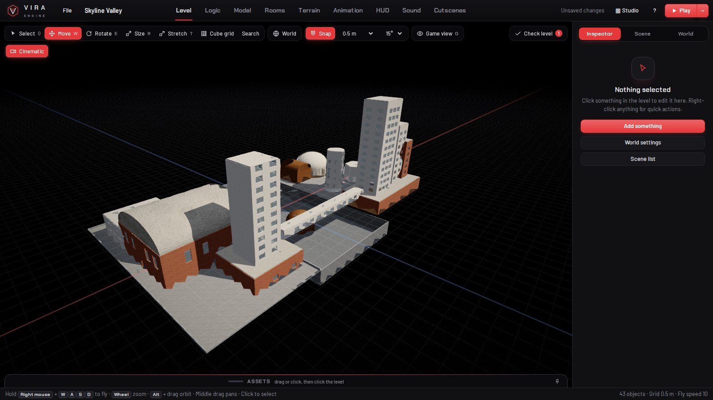
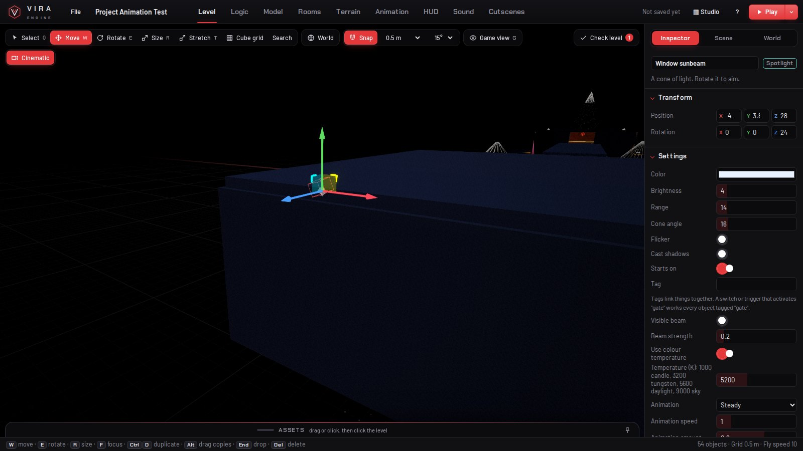
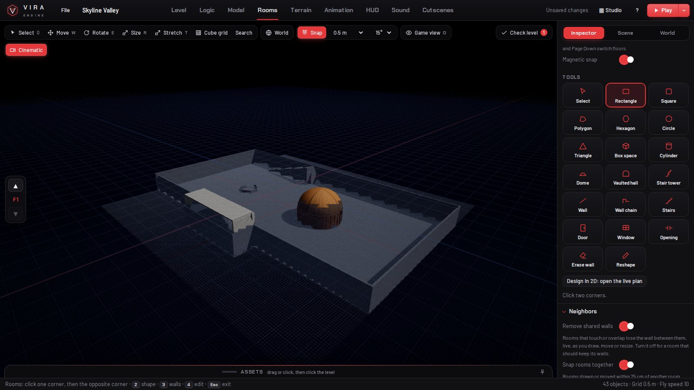
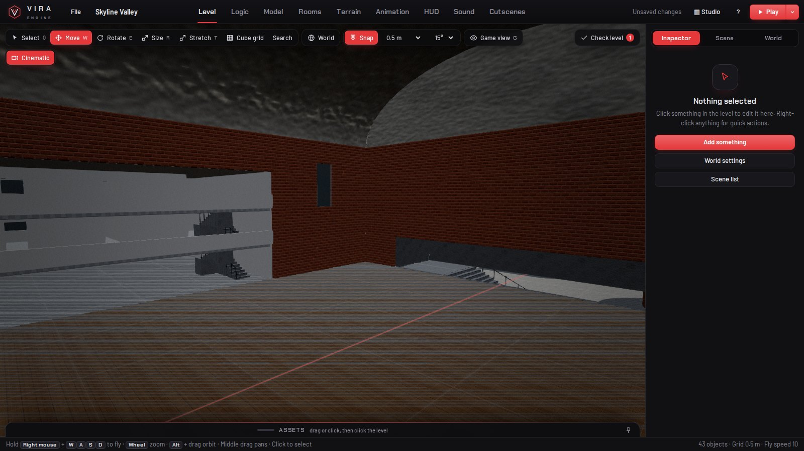
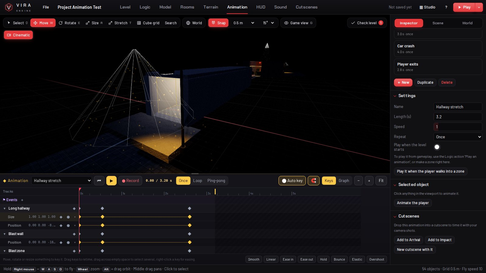
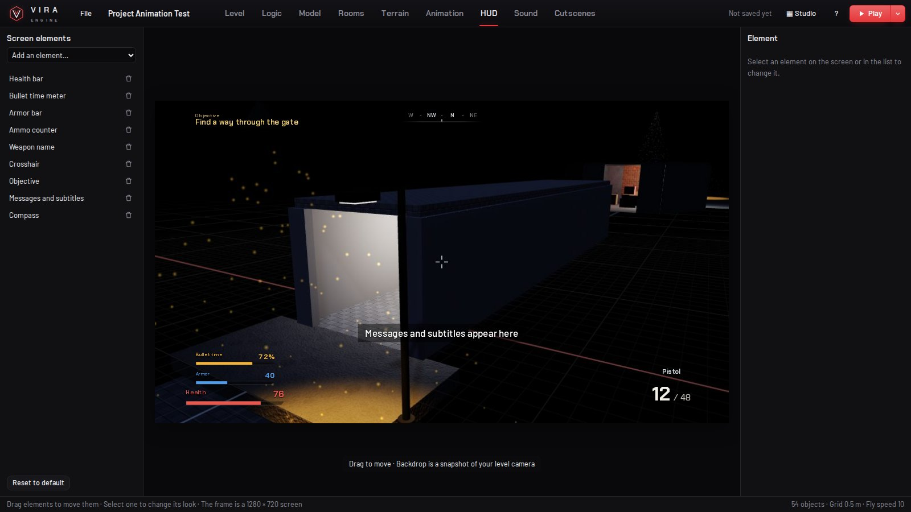
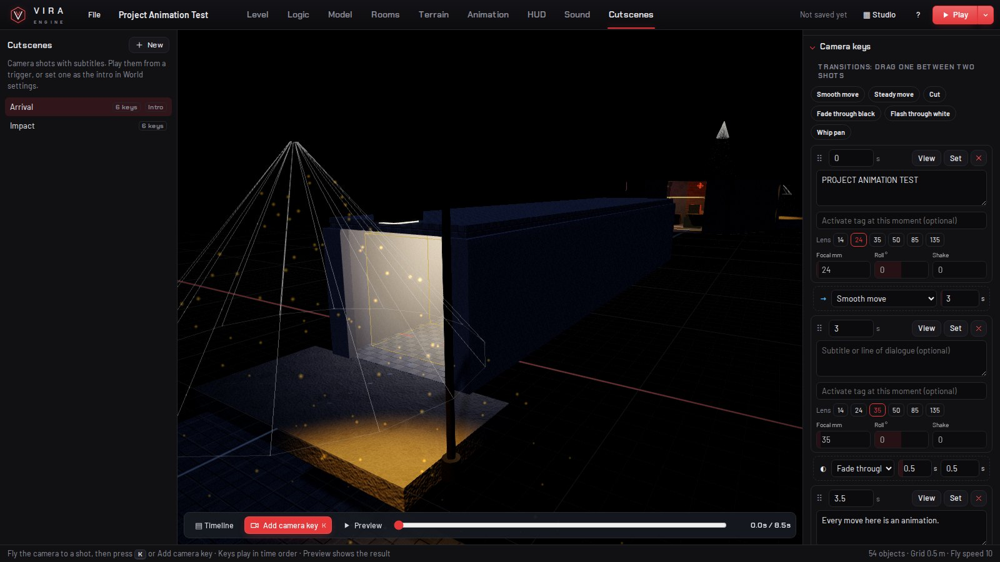

# Vira Engine

A passion project by Ramtin Mohammadi ([@Ramtinvibes](https://instagram.com/ramtinvibes)).

Vira Engine is a no-code 3D game engine that runs offline as a single HTML file. You build the level, logic, models, rooms, terrain, animation, HUD, sound and cutscenes in one window, then press Play to test.

## Level
- Move, rotate, size and stretch objects with a gizmo (Q W E R T), with grid and angle snapping.
- Shift-click or drag a box to select several objects, then move, rotate or delete them together.
- Game view (G) and a cinematic preview inside the editor.
- Lights with colour temperature, 12 animation modes (candle, fire, fluorescent, broken neon, strobe, lightning, alarm beacon and more), dust in the beam, light shafts and falloff, plus 20 light presets.
- Check level lists problems before you play.

## Logic
- Logic Tiles: behaviors read as sentences (when this happens, check this, do that) instead of node graphs.
- Tiles, Reactor and Templates views, variables and a debugger.

## Model
- Build props from Box, Cylinder, Sphere, Cone, Ring, Capsule, Wedge, Pipe, Dome, Prism and Panel.
- Group, ungroup, duplicate and mirror parts, or start from a template (furniture, street props, containers, building parts).
- Save models to the library with collision settings and place them in the level.

## Rooms
- Draw rooms as rectangles, polygons or circles, or build 3D spaces: box, cylinder, dome, vaulted hall and stair tower.
- Rooms that touch or overlap merge into one space at any height. Walls open only where both rooms share height, and you can switch merging off per room.
- Rooms dropped within 75 cm of each other snap together.
- Doors, windows and openings go on any wall at any height, with a ghost preview and a frame.
- Floors with Page Up and Page Down, stairs that cut through the floor above, switchback stairs and ramps.
- Styles: Apartment, Brick loft, Warehouse, Bunker, Saloon, Office.

## Terrain
- Start from Flat, Rolling hills, Mountains, Island, Valley or Desert, from 64 to 256 m, then sculpt.

## Animation
- Keyframe position, rotation, size and visibility on a timeline, with a graph view for curves.
- Easing presets, record mode, and events for explosions or logic.
- Play once, loop or ping-pong, from Logic or inside a cutscene. Moving platforms carry the player.

## HUD
- Health bar, ammo counter, weapon name, crosshair, objective, messages and subtitles, and a compass, placed by dragging.

## Sound
- A built-in sound maker with presets such as pistol, shotgun, explosion, glass, door, footstep, rain and thunder.
- Import your own audio.
- A mixer with master, effects, music, ambient and interface channels.

## Cutscenes
- Camera shots on a timeline with lens choice, handheld shake, fades and cuts, speed ramps, subtitles and animation clips.

## Example projects
Starter level, Gameplay test, Noir test, Skyline Valley, Project Animation Test, Logic Tiles test, Empty level, Roguelike dungeon, Open world.
